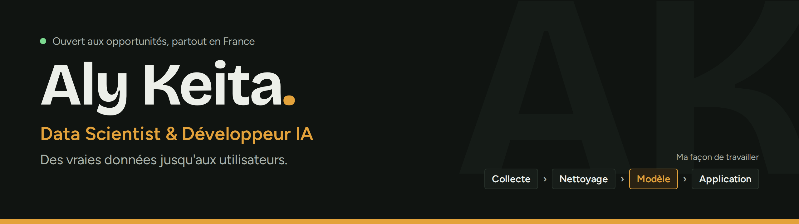
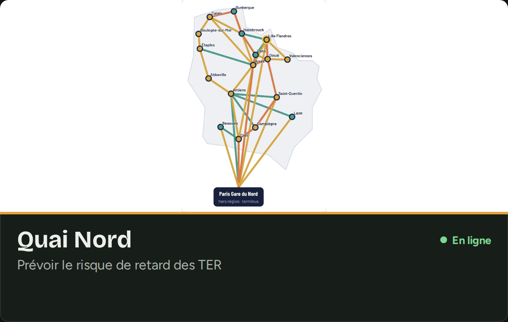
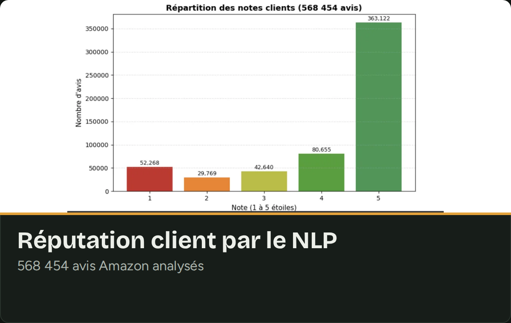
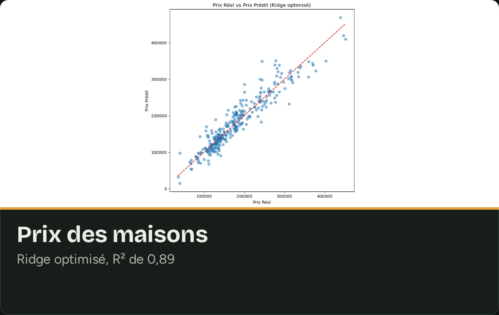
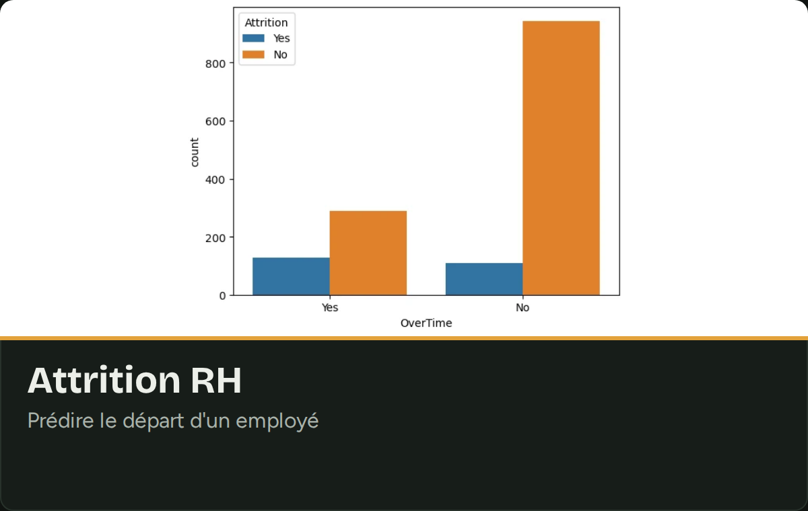
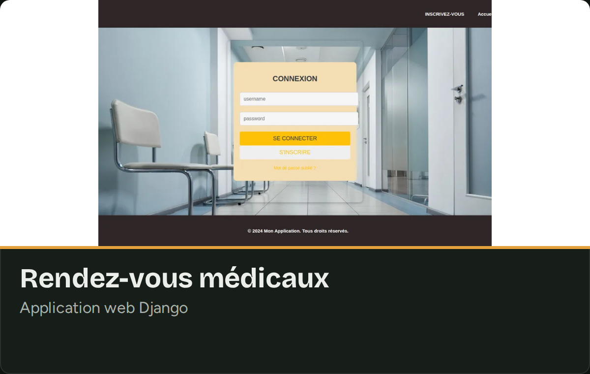
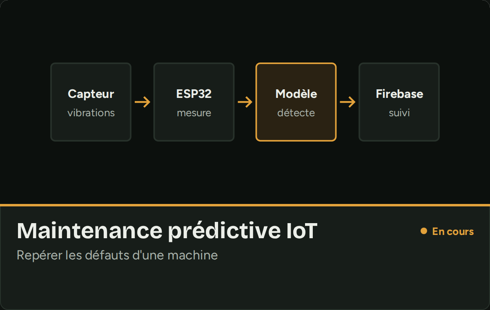
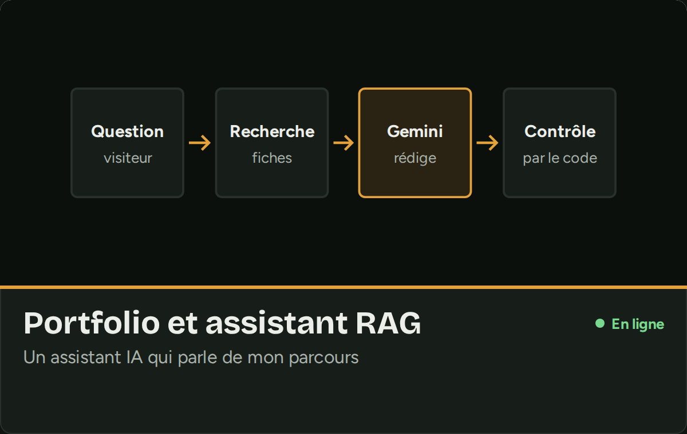

Étudiant en **Master 2 Ingénierie des Systèmes Complexes à l'EILCO** (Calais). Je ne m'arrête pas au modèle : je collecte et nettoie les données, je construis le modèle, puis je vais jusqu'à l'outil que les gens utilisent vraiment.

## Projet phare : Quai Nord

**Prévoir le risque de retard d'un TER des Hauts-de-France avant de partir.**

- Les retards SNCF sont collectés **toutes les 5 minutes** sur une VM Google Cloud, croisés avec les horaires et la météo : **775 550 passages analysés**.
- Lissage bayésien, puis un modèle de prédiction évalué sur des semaines jamais vues.
- **Nora**, une assistante IA (Gemini, FastAPI), guide vers le bus, le tram ou le métro, et **le code vérifie chacune de ses réponses**.

**[Voir le site](https://quai-nord.web.app)** · **[Le code](https://github.com/Aly2001/quai-nord)**

 

## Autres projets

<table>
<tr><td width="50%"></td><td width="50%"></td></tr>
<tr><td width="50%"></td><td width="50%"></td></tr>
<tr><td width="50%"></td><td width="50%"></td></tr>
</table>

## Mes outils

**Data et machine learning** 
      

**IA générative** 
   

**Développement** 
      

**Bases de données, cloud et visualisation** 
     

## Parcours

🇲🇱 **Mali** · Bac scientifique (2021) → 🇲🇦 **Maroc** · Licence Mathématiques-Informatique, puis stage de Data Scientist chez Bank Al-Maghreb → 🇫🇷 **France** · Master 2 à l'EILCO *(en cours)*

 <a href="https://alykeita.com"><b>alykeita.com</b></a>

